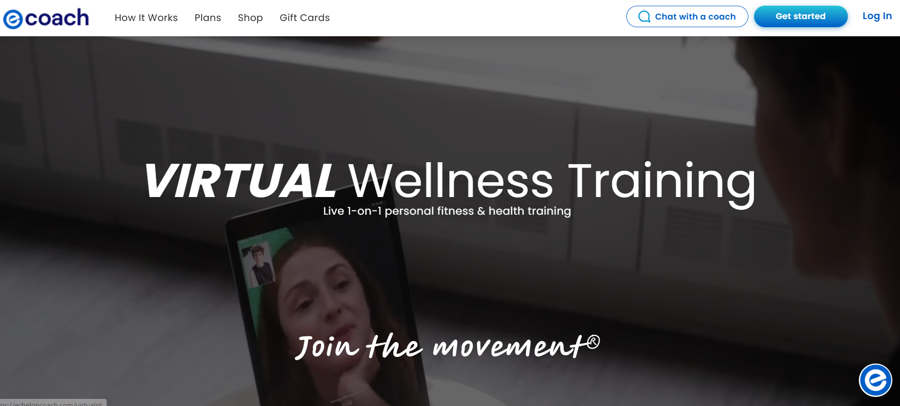

# Echelon Coach API HTTPS Recovery

A technical case study documenting production HTTPS recovery for the Echelon Coach virtual training platform.

**Live platform:** [Echelon Coach Virtual PT](https://echeloncoach.com/virtualpt/ )

## Context

Echelon Coach provides live, one-to-one virtual fitness and wellness training. The customer-facing application depends on a secure HTTPS connection to its API.

## Problem

An expired TLS certificate disrupted the secure HTTPS connection used by the application API. Recovery required diagnosing the server and reverse-proxy configuration, replacing the certificate, and verifying the connection.

## Solution

The recovery work included:

- Diagnosing the HTTPS and reverse-proxy configuration on AWS-hosted Linux infrastructure
- Installing Certbot and its Nginx integration
- Issuing a new Let’s Encrypt certificate for the application endpoint
- Applying the certificate through the active Nginx configuration
- Validating the Nginx configuration and reloading the service
- Confirming a valid HTTPS response after recovery
- Verifying automated certificate renewal through the operating system service

## Result

The secure API connection was restored, and the automated certificate-renewal path was confirmed. The work covered infrastructure recovery, reverse-proxy configuration, TLS validation, and customer-facing application availability.

## Technology

- AWS
- Linux / Ubuntu
- Nginx
- SSL/TLS
- Let’s Encrypt
- Certbot
- systemd
- SSH

---

**Lead Developer:** Nícolas Cartín Reyes

## Session media reliability remediation

The production issue involving missing trainer media on desktop and sideways trainer video on mobile is documented in [Echelon Coach session media reliability remediation](case-studies/coach-session-media-reliability-remediation.md).

The public documentation covers the problem, root cause, defensive Agora lifecycle design, bounded retries, video metadata handling, validation approach, and engineering outcome. It does not include private source code, credentials, infrastructure identifiers, customer information, or operational access details.

**Lead Developer:** Nicolás Cartín Reyes
